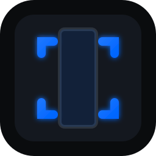

<div align="center">
  
  <h1>ReframeDesk</h1>
  <p><strong>Sua nuvem GoPro, editor Reframe, câmera BLE/USB-C e conversão FFmpeg com GPU direto no Windows.</strong></p>

  <p>
    <a href="https://github.com/denilsonbslv/reframedesk-releases/releases/tag/v2.2.0">
      
    </a>
    
    <a href="https://reframedesk.vercel.app">
      
    </a>
    <a href="https://github.com/denilsonbslv/reframedesk-releases/releases/latest">
      
    </a>
  </p>
</div>

---

O **ReframeDesk** é um aplicativo desktop nativo para **Windows** (**Tauri v2 + WebView2**) projetado para oferecer a experiência completa de gerenciar sua nuvem **GoPro**, editar vídeos com reenquadramento (**Reframe**), conectar sua câmera por **Bluetooth (BLE) / Wi-Fi / USB-C** e converter arquivos localmente com **FFmpeg acelerado por placa de vídeo (GPU)** — tudo com arquitetura **local-first**, rápida e privada.

> **Aviso de marcas:** GoPro® e Quik® são marcas registradas da GoPro, Inc. Este projeto é independente e não possui afiliação ou endosso da GoPro.

---

## Download Oficial (`v2.2.0`)

- **Página oficial / Landing page:** **[reframedesk.vercel.app](https://reframedesk.vercel.app)**
- **Instalador direto para Windows (`117,4 MB`):** **[ReframeDesk-Setup-2.2.0.exe](https://github.com/denilsonbslv/reframedesk-releases/releases/download/v2.2.0/ReframeDesk-Setup-2.2.0.exe)**
- **Notas da versão:** **[GitHub Releases v2.2.0](https://github.com/denilsonbslv/reframedesk-releases/releases/tag/v2.2.0)**
- **Verificação de integridade (`SHA-256`):**
  ```text
  92da086806dd8347da80ababced0f956dd1be2eba6d0e9533542b625089bcf11
  ```

### Como instalar ou atualizar

1. Baixe e execute **`ReframeDesk-Setup-2.2.0.exe`**.
2. O aplicativo já inclui **Node.js, FFmpeg/FFprobe e WebView2 nativo** (sem necessidade de extensões de navegador).
3. **Já usa uma versão anterior?** Basta executar o novo instalador por cima da instalação existente — seus dados e preferências permanecem preservados.

---

## Principais Funcionalidades

- **Biblioteca na Nuvem GoPro:** listagem completa, busca e filtros por tipo (vídeos, fotos, projetos editados, time-lapse, burst e loop), lixeira e criação de **Álbuns compartilháveis (`gopro.com/v/...`) gratuitamente no plano Free**.
- **Preview Direto da Nuvem:** reprodução direta sem baixar para o PC (`Original · Recomendada` no Free; alternância entre Alta Resolução, Proxy de edição, versão renderizada e Fonte bruta no Pro).
- **Conexão Rápida com Câmera GoPro:**
  - **Bluetooth BLE em 1 clique** com memória de câmera, **painel dinâmico de ajustes HERO13+**, presets rápidos, gestão do cartão SD (`0x41`/`0x42`), leitura real de espaço livre e sinal **Localizar câmera**.
  - **Transferência rápida via cabo USB-C** (40–60 MB/s mantendo o computador conectado à internet via Wi-Fi) ou Wi-Fi direto.
  - Controle de captura adaptado para Vídeo/Foto, marcação de itens já baixados, visualização de mídias da câmera e download livre no Free.
- **Editor Reframe na Nuvem *(Pro)*:** grade visual interativa, **rotação `0°–270°` em vídeos e fotos**, zoom com proporção travada (`16:9`, `9:16`, `4:3`, `8:7`, `1:1`), lentes **SuperView**, **HyperView**, **Wide** e **Linear** (com suporte a **Ultra Grande Angular / Max Lens**), **figurinhas de telemetria nos 4 cantos com sobreposição e prévia renderizada**, captura de frame na nuvem, ajustes de cor/luz + **Automático** e **Exportação em lote YouTube/Instagram**.
- **Upload em Fila para a Nuvem *(Pro)*:** seleção múltipla de fotos JPG originais, vídeos GoPro e cortes trim MP4 com verificação automática de duplicatas na nuvem antes de enviar.
- **Download & Fila Local FFmpeg com GPU:**
  - **No Free:** escolha livremente qualquer versão/resolução pronta da nuvem e baixe sem recodificar (Resolução, FPS e Codec originais + Taxa de bits Padrão).
  - **No Pro:** re-codificação H.264 / H.265, alteração de resolução (até 4K), FPS, bitrate, renderização em **4K direto da fonte bruta** (incluindo rotação), download direto de **fotos editadas JPG** e **aceleração por placa de vídeo (NVENC / hardware)**.
- **Auto-Updater Seguro:** verificação automática via `public/latest.json` com checagem rigorosa de **SHA-256** antes da execução, além do canal opcional **Early Access (Beta)** exclusivo para assinantes **Pro Vitalício**.

---

## Planos: Free vs Pro

Novos computadores elegíveis recebem **7 dias grátis de ReframeDesk Pro** após confirmar o e-mail (sem necessidade de cartão de crédito).

| Plano | Valor | Computadores | Destaques |
|-------|-------|--------------|-----------|
| **Free** | **R\$ 0** | 2 PCs | Conectar câmera GoPro, baixar resoluções originais da nuvem, preview Original (Recomendada) e **Álbum compartilhável** |
| **Pro Mensal** *(Recorrente)* | **R\$ 14,99/mês** | 2 PCs | Editor Reframe, Exportação em lote, Upload, Preview HD/Fonte Bruta, FFmpeg 4K + GPU · Cancele quando quiser no app |
| **Pro Avulso** *(30 dias)* | **R\$ 19,99** único | 2 PCs | Todos os recursos Pro por 30 dias exatos sem renovação automática |
| **Pro Anual** | **R\$ 149,00/ano** | 3 PCs | Todos os recursos Pro por 365 dias · Pix à vista ou parcelamento em até 12x no Asaas\* |
| **Pro Vitalício** | **R\$ 249,00** único | **4 PCs** | Acesso permanente sem mensalidades · **★ Canal Early Access (Beta)** · Direito preservado caso recrie a conta com o mesmo e-mail |

> **Disponibilidade atual do Pro:** A versão pública `v2.2.0` já funciona integralmente no modo **Free** (e com **7 dias grátis de avaliação Pro** em novos PCs). A ativação comercial dos pagamentos recorrentes/avulsos está atualmente em homologação (Asaas Sandbox) antes da abertura definitiva para produção.

<details>
<summary><strong>Diretrizes de pagamento, parcelamento e CDC (Asaas Instituição de Pagamento S.A.)</strong></summary>

- **Zero dados bancários no app:** o pagamento ocorre na página oficial segura do **Asaas** (Pix à vista sem taxa extra da plataforma; juros de parcelamento no cartão/IOF são exibidos claramente antes de confirmar).
- **Arrependimento legal (Art. 49 do CDC):** garantido em até **7 dias corridos** na primeira contratação online.
- **Cancelamento do Mensal Recorrente:** sem fidelidade; interrompe futuras cobranças na hora e mantém o acesso pelos dias restantes já pagos (sem reembolso proporcional do ciclo iniciado).
- **Parcelamento (\*):** enquanto as parcelas estiverem em dia, os recursos Pro permanecem ativos (`Pro Vitalício*` no Vitalício parcelado). Em caso de atraso superior a **24 horas** após o vencimento, a conta retorna automaticamente ao plano **Free** até regularizar; quitando a última parcela, consolida-se o **Pro Vitalício ★** permanente.

</details>

---

## Privacidade & Segurança (LGPD)

- **100% Local-First:** a interface roda em `127.0.0.1` no seu computador; tokens GoPro ficam em cookies `httpOnly` locais e o vínculo automático opcional usa **cofre local criptografado (`AES-256-GCM`)**.
- **Zero mídias ou senhas GoPro na nuvem do projeto:** nunca armazenamos seus vídeos, fotos ou credenciais GoPro nos servidores do ReframeDesk.
- **Zero PII no servidor de licenças:** e-mails e máquinas são indexados por hashes criptográficos irreversíveis (`HMAC-SHA256` / `SHA-256`), com **exclusão permanente em 1 clique** dentro do aplicativo (`Conta → Apagar conta`) e preservação anônima do direito **Pro Vitalício**.

---

## Sobre este repositório

Este repositório público (`denilsonbslv/reframedesk-releases`) hospeda exclusivamente:
- A **landing page** publicada na Vercel ([reframedesk.vercel.app](https://reframedesk.vercel.app)) em [`public/`](public/)
- O manifesto de atualização [`public/latest.json`](public/latest.json)
- As **GitHub Releases** com o instalador oficial assinado/verificado `ReframeDesk-Setup-*.exe`

O código-fonte do produto é **proprietário** e mantido no repositório privado `reframedesk`.
